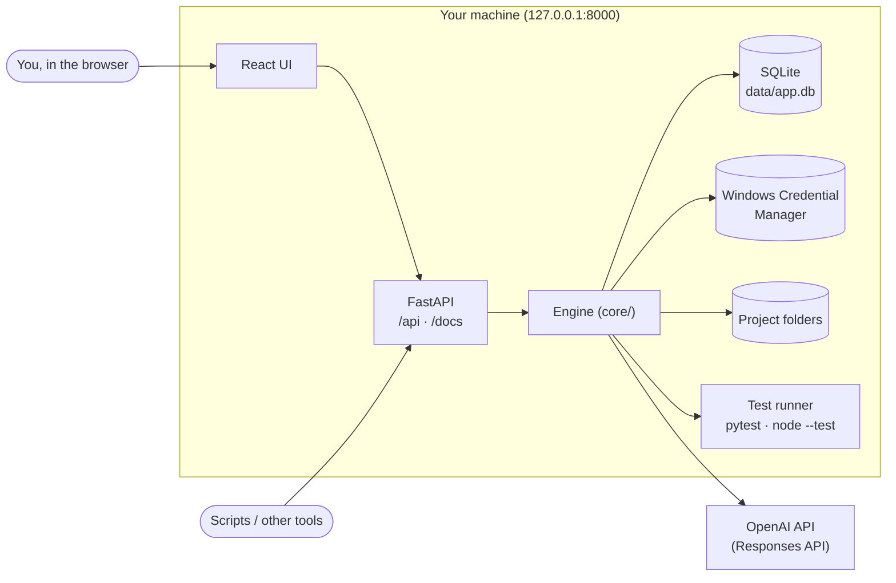
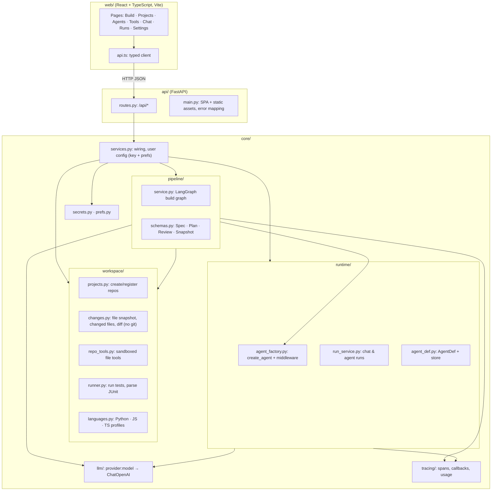
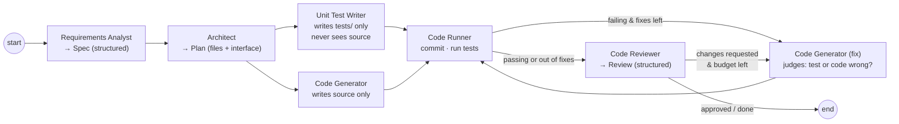
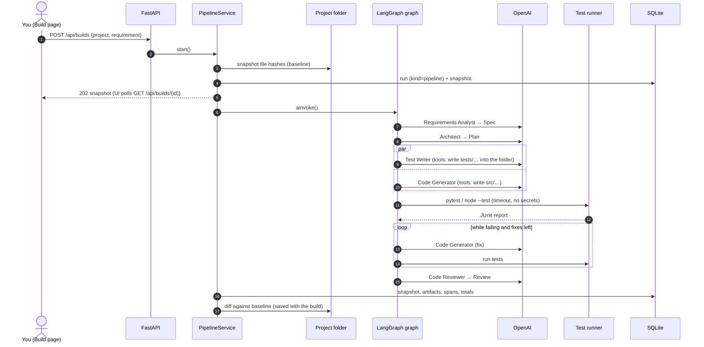

# Codeloom Architecture

How Codeloom is built: the parts, how a build flows through them, and where data lives. Diagrams are Mermaid (they render on GitHub and in VS Code with a Mermaid extension). The *why* behind each choice is in [DECISIONS.md](DECISIONS.md).

**Status legend:** ✅ built · 🔜 planned.

---

## 1. Principles

1. **One server, one URL.** FastAPI serves the REST API (`/api`), Swagger (`/docs`) and the React UI (`/`).
2. **The engine is UI-independent.** All logic lives in `core/`. `api/` is a thin HTTP layer and `web/` is a thin client.
3. **LangChain + LangGraph do the agent mechanics.** We own the build pipeline, workspace sandboxing, tracing, settings and UI.
4. **Agents are data.** The six-agent build team is YAML (`config/agents/`), editable in the UI.
5. **Safe by default.** Localhost only; agents write only inside the project folder through sandboxed tools; the app never runs git; the API key lives in the OS credential store; git is never pushed.
6. **Everything is observable.** Every model and tool call is a span with tokens, latency and cost.

---

## 2. System context



---

## 3. Components



| Package | Responsibility | Status |
|---|---|---|
| `web/` | React UI: build console, projects, agents, tools, chat, traces, settings, usage header | ✅ |
| `api/` | REST API under `/api`, Swagger, serves the UI | ✅ |
| `core/pipeline/` | The build team as a LangGraph `StateGraph` | ✅ |
| `core/workspace/` | Projects (any folder), change tracking, sandboxed repo tools, test runner, language profiles | ✅ |
| `core/runtime/` | Agent definitions, agent factory (`create_agent` + middleware), chat/agent runs | ✅ |
| `core/llm/` | `"provider:model"` → LangChain chat model; model listing; scripted fake for tests | ✅ |
| `core/tracing/` | Tracer, LangChain callback handler, redaction, usage queries | ✅ |
| `core/secrets.py`, `core/prefs.py` | API key in the OS credential store; preferences in SQLite | ✅ |
| `core/tools/` | Tool registry + built-in tools | ✅ |
| `core/mcp/` | MCP manager (persistent sessions, tool registration), config import, public registry client | ✅ |
| `core/skills/` | SKILL.md skills: store, prompt section, `skill__load` / `skill__read_file` tools | ✅ |
| Human approval gates | Approve spec / approve merge mid-build (`interrupt()`) | 🔜 |

---

## 4. The build pipeline



- **Structured outputs:** Spec, Plan and Review use `with_structured_output`, with Pydantic schemas validated by the API.
- **Tool-using stages:** the test writer, code generator and fixer are `create_agent` graphs with workspace tools (`repo__list_files/read_file/write_file/delete_file`) bound to the project folder, plus per-stage permissions:
  - The **test writer** may write only under `tests/` and cannot read source files.
  - The **code generator** may not write tests.
  - The **fixer** may edit both. It must decide per failure whether the test or the implementation is wrong.
- **Parallelism:** tests and code are written at the same time; LangGraph joins both before the runner.
- **Loop bounds:** at most N fix attempts (default 3) and at most 1 review round of fixes. The reviewer always runs, even when fixes are exhausted.
- **Outcome:**
  - `done`: tests pass and the reviewer approved.
  - `needs_attention`: otherwise.
  - `failed` or `cancelled`: the run errored or was stopped.
  - In every case the files are already in the project folder. There is no merge step and no commit (ADR-023).
- **Change tracking:** a snapshot of file hashes is taken before the build; changed files and the diff are computed against it, and the final diff is saved with the build.

### Run, step by step



---

## 5. Data

```mermaid
erDiagram
    repositories ||--o{ runs : "builds (kind=pipeline)"
    runs ||--o{ spans : traces
    runs ||--o{ run_artifacts : "spec, plan, test_report, review, snapshot"
    agents { string name UK; string kind "llm|step"; string role; string model; text system_prompt; json tool_ids_json }
    repositories { string id PK; string name UK; string path; string language_id; string base_branch }
    runs { string id PK; string kind "pipeline|agent|chat"; string status; int model_calls; int tool_calls; int input_tokens; int output_tokens; float cost_usd; string branch; string final_action }
    spans { string id PK; string run_id FK; string parent_span_id; string type "agent|llm|tool"; json input_json; json output_json; int tokens_in; int tokens_out }
    app_settings { string key PK; json value_json }
```

- **SQLite** (`data/app.db`): agents, tools, projects, runs, spans, artifacts, preferences. New columns are added automatically on startup (additive migrations).
- **OS credential store** (Windows Credential Manager, service `agent-orchestration`): the OpenAI key and optional GitHub token. Entered in the UI only; environment variables are ignored.
- **Project folders:** new projects live in `workspaces/<name>` (or a folder you choose). Builds write into the project folder itself; no git, no build copies.
- **Config:** `config/agents/*.yaml` (default team, seeded when missing) and `config/prices.yaml` (edited from Settings).

---

## 6. Interfaces

| Interface | Where |
|---|---|
| UI | http://127.0.0.1:8000 |
| Swagger / ReDoc | `/docs`, `/redoc`, spec at `/openapi.json` |
| Builds | `POST /api/builds`, `GET /api/builds[/{id}]`, `POST /api/builds/{id}/cancel`, `POST /api/builds/{id}/finish`, `GET /api/builds/{id}/file`, `GET /api/builds/{id}/diff` |
| Projects | `GET/POST /api/projects`, `GET/DELETE /api/projects/{id}`, `GET /api/projects/{id}/files`, `GET /api/projects/{id}/file` |
| Agents | `GET /api/agents`, `PUT/DELETE /api/agents/{name}`, `GET /api/agents/{name}/yaml`, `POST /api/agents/import`, `POST /api/agents/restore-defaults` |
| Tools | `GET /api/tools`, `PATCH /api/tools/{name}`, `POST /api/tools/{name}/invoke` |
| MCP | `GET /api/mcp/servers`, `PUT/DELETE /api/mcp/servers/{name}`, `POST /api/mcp/servers/{name}/connect`, `.../disconnect`, `POST /api/mcp/import`, `GET /api/mcp/registry` |
| Skills | `GET /api/skills`, `GET/PUT/DELETE /api/skills/{name}` |
| Chat & runs | `POST /api/chat`, `POST /api/runs`, `GET /api/runs[/{id}]`, `POST /api/runs/{id}/cancel`, `GET /api/runs/{id}/spans` |
| Settings | `GET /api/settings`, `POST/DELETE /api/settings/openai-key`, `PUT /api/settings/preferences`, `GET/PUT /api/settings/prices`, `PUT/DELETE /api/settings/github-token` |
| System | `GET /api/health`, `GET /api/usage`, `GET /api/models`, `GET /api/languages`, `POST /api/system/pick-folder` (native Windows folder dialog), `GET /api/system/folders` (in-app folder browser) |

---

## 7. Security boundaries

| Boundary | Control |
|---|---|
| Network | Server binds to 127.0.0.1; no auth (local use only) |
| API key | Entered in the UI, verified, stored in the OS credential store; never in SQLite, logs or traces (redacted) |
| Generated code location | Directly in the project folder (ADR-023); one build per project at a time |
| File tools | Paths resolved inside the project folder; `..`, absolute/drive/UNC paths, `:` streams, `.git/`, `.env*`, key files rejected; per-stage read/write rules |
| Running generated tests | Inside the project folder, with a timeout that kills the process tree, and secret-looking env vars removed |
| Git | Never run by the app (no init, branch, commit, merge or push) |
| Runaway agents | Per-agent model-call and tool-call limits; bounded fix and review loops |
